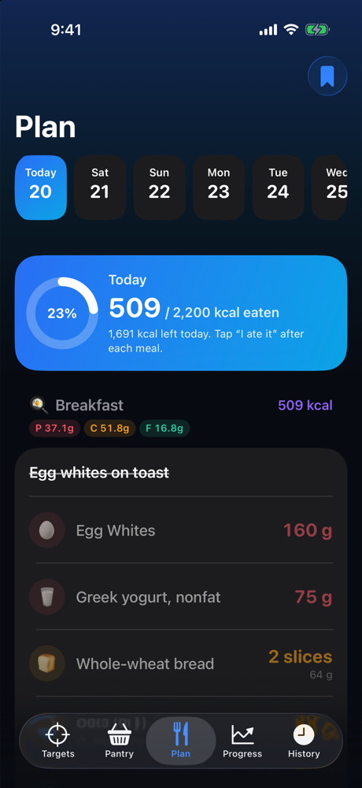
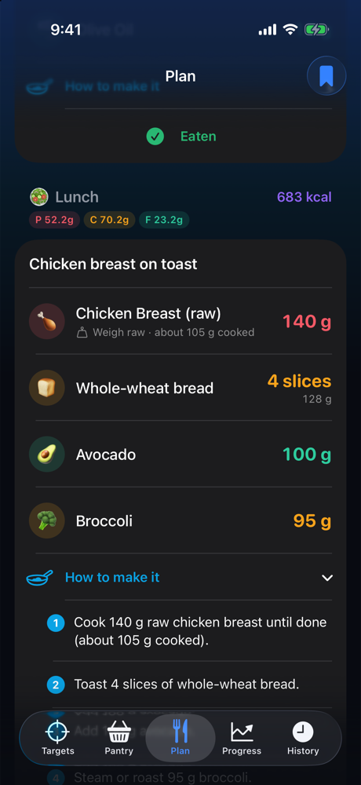
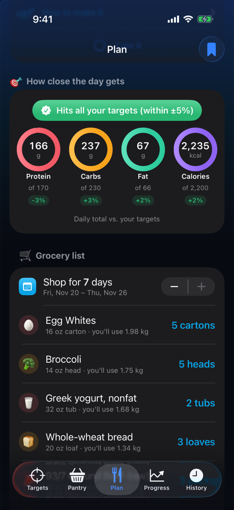
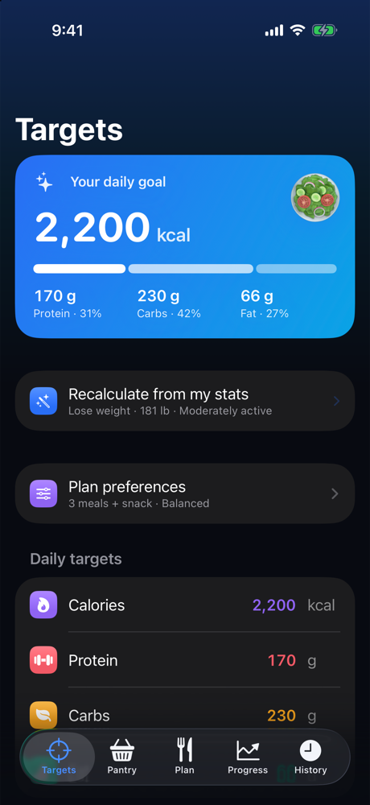
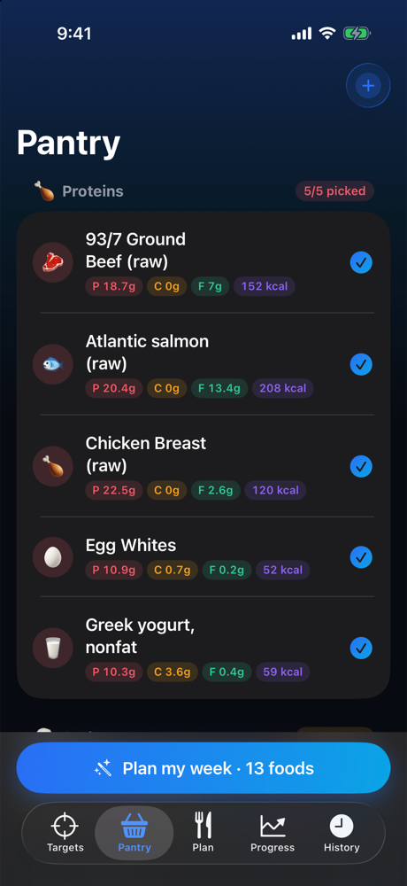
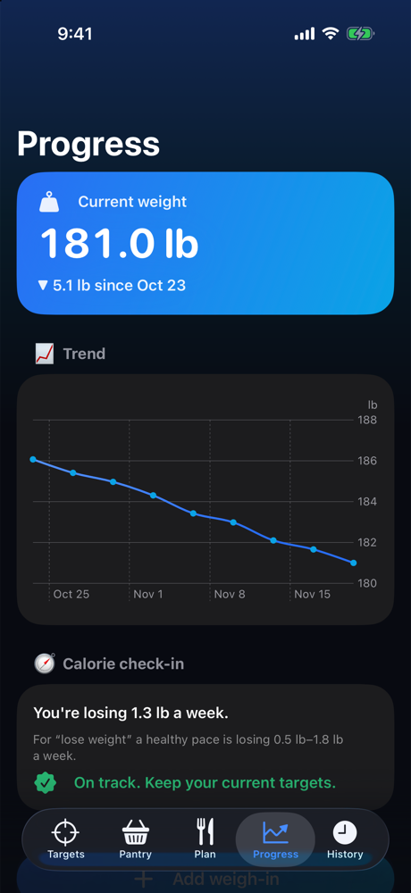

# Macro Router (iOS)

Tell it your daily macros and the foods you want to eat. It calculates the exact gram weights to prep each day and a multi-day grocery list.

<table>
  <tr>
    <td align="center"><br><sub>Week plan</sub></td>
    <td align="center"><br><sub>Meals and cooking steps</sub></td>
    <td align="center"><br><sub>Macros and grocery list</sub></td>
  </tr>
  <tr>
    <td align="center"><br><sub>Targets</sub></td>
    <td align="center"><br><sub>Pantry</sub></td>
    <td align="center"><br><sub>Progress</sub></td>
  </tr>
</table>

- **SwiftUI**, iOS 17+
- **On-device optimizer** (`Packages/MacroCore`): box-constrained weighted least squares. Every macro is measured as relative error, and you can set optional min/max grams per food. It returns the best possible plan even when the selected foods can't hit the targets exactly, and reports which macros miss the ±5% margin.
- **A week at a time**: plans 7 days; lunch and dinner proteins and carbs rotate from day to day. Tap "I ate it" after a meal to track today's calories, or swipe a food to drop it for that day and re-plan the rest.
- **Preferences** (Targets > Plan preferences): breakfast on/off, afternoon snack, meal sizes, diet filters (vegetarian, pescatarian, no pork/beef, dairy-free, gluten-free) and meal reminders.
- **Progress tab**: weigh-ins, trend chart, Apple Health import, and a calorie check-in after 2 weeks that suggests eating more or less.
- **Meal names and cooking steps** built from each meal's foods, e.g. "Chicken breast & rice bowl with broccoli".
- **Breakfast, lunch and dinner**: each meal is solved separately from foods that suit it (oats and eggs at breakfast, meat and rice later), lunch and dinner get different mains when there are enough foods, and every selected food is used. Override a food's meals in the food editor.
- **Grocery list in packs**: "2 packs ground beef", "10 cans", "1 dozen", from typical US package sizes guessed from the food's name. Set your own size in the food editor.
- **Guided setup**: on first launch it asks for goal (lose, maintain, gain), sex, age, height, weight and activity, then suggests daily targets (Mifflin-St Jeor) that the user can edit. Redo it anytime from Targets.
- **Any food**: 7 pre-seeded staples, **USDA FoodData Central search**, or a **custom food** entered from a nutrition label.
- **Firebase Auth + Firestore** (optional). Without a Firebase config the app runs in local-only mode.

## 1. Requirements
- A Mac with **Xcode 15.3+** (Xcode 16 recommended)
- [XcodeGen](https://github.com/yonaskolb/XcodeGen), which generates the `.xcodeproj` from `project.yml`:

```bash
brew install xcodegen
```

## 2. Generate and open the project

```bash
cp Config/Secrets.example.xcconfig Config/Secrets.xcconfig
```

Edit `Config/Secrets.xcconfig`:
- `PRODUCT_BUNDLE_IDENTIFIER`: something unique, e.g. `com.yourname.macrorouter`
- `DEVELOPMENT_TEAM`: your Personal Team ID (see the file's comments)
- `USDA_API_KEY`: a free key from https://fdc.nal.usda.gov/api-key-signup. `DEMO_KEY` works, but only for a few searches an hour.

```bash
xcodegen
```

```bash
open MacroRouter.xcodeproj
```

The first open resolves the Firebase Swift package, which takes a few minutes.

## 3. Run it
- **Simulator**: pick an iPhone simulator and press ⌘R.
- **Your iPhone, without the paid developer program**:
  1. In Xcode > Settings > Accounts, add your Apple ID.
  2. Plug in the phone and enable Developer Mode (Settings > Privacy & Security).
  3. Select the phone and press ⌘R.
  4. On the phone, trust the developer under Settings > General > VPN & Device Management.

  Free provisioning installs expire after **7 days**. Run again from Xcode to reinstall. TestFlight and the App Store require the $99/yr Apple Developer Program.

## 4. Tests
⌘U in Xcode, or from the terminal:

```bash
cd Packages/MacroCore && swift test
```

## 5. Turn on accounts and cloud sync (optional)
1. Create a project at https://console.firebase.google.com and add an **iOS app** with the same bundle ID as in `Secrets.xcconfig`.
2. Download `GoogleService-Info.plist` into the `MacroRouter/` folder. It is git-ignored.
3. Under **Authentication > Sign-in method**, enable **Email/Password**.
4. Under **Firestore Database**, create a database. In the **Rules** tab, paste in `firestore.rules` and publish.
5. Run `xcodegen` again so the plist is added to the app, then build.

On the first sign-in, data the user created in local mode is uploaded to the cloud.

## Firestore layout
| Path | Fields |
|---|---|
| `users/{uid}` | `target_calories`, `target_protein`, `target_carbs`, `target_fats`, `selected_ingredient_ids`, `onboarding_done`, `body_profile {sex, age, height_cm, weight_kg, activity, goal, uses_metric}` |
| `users/{uid}/pantry/{id}` | `name`, `source`, `macros_per_100g {protein, carbs, fat, calories}`, `min_grams`, `max_grams`, `meals`, `package {unit, grams}` |
| `generated_plans/{plan_id}` | `plan_id`, `uid`, `daily_weights`, `achieved_macros`, `created_at`, `plan_json` |

## Project layout
```
project.yml                     XcodeGen spec
Config/                         xcconfig (bundle id, team, USDA key)
Packages/MacroCore/             pure-Swift engine + tests (no UIKit/Firebase)
  Macros.swift                  Macros, MacroTargets
  Ingredient.swift              Ingredient + seeded staples (raw/dry values, per 100 g)
  MacroSolver.swift             the optimizer
  MealPlan.swift                results, ±5% check, suggestions
  GroceryList.swift             N-day list, "1.25 kg" formatting, share text
  USDAFood.swift                FoodData Central response parsing
MacroRouter/
  App/                          app entry + AppState (state, persistence, sync)
  Services/                     AuthService, CloudStore (Firestore), LocalStore, FoodSearchService
  Views/                        Targets, Pantry, Food search, Food editor, Plan, History, Login
```

## Notes
- Staples use **as-purchased** values (raw chicken, dry rice), so the grocery list shows real shopping weights. The recipe weights are raw/dry as well, so weigh food before cooking.
- The PRD calls for Auth0. This app uses Firebase Auth instead, which covers the same need with one fewer vendor. Sign in with Apple can be added once you have a paid developer account.
